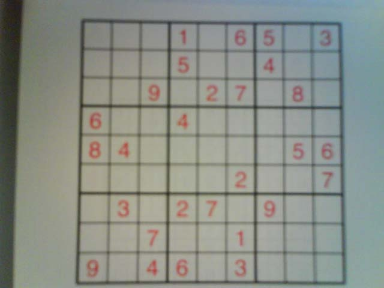
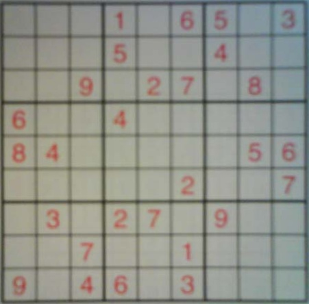
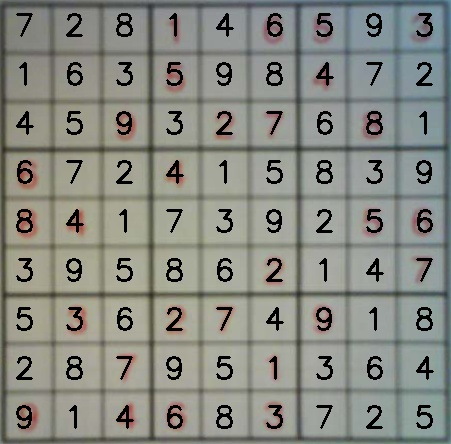

# Sudoku Solver with Computer Vision & Deep Learning

An image-to-Sudoku experiment using OpenCV to extract the grid, a PyTorch CNN to
recognize digits, and backtracking to solve the predicted puzzle. The repository
also includes training and evaluation code for ConvNet and ResNet152.

## Pipeline in Action

|                           Original Image                           |                               Extracted Grid                                |                         Solved Sudoku                          |
| :----------------------------------------------------------------: | :-------------------------------------------------------------------------: | :------------------------------------------------------------: |
|  |  |  |
|                          Raw input image                           |                           Detected & warped grid                            |                    Final solution overlaid                     |

## Features

- **Image Processing**: Automatic Sudoku grid detection and cell extraction
- **Digit Recognition**: CNN and ResNet152 models for handwritten digit classification
- **Sudoku Solving**: Backtracking algorithm for puzzle solving
- **Transfer Learning**: Pre-training on MNIST with fine-tuning on Sudoku datasets

## Project Structure

```
src/
├── common/          # Utility functions (config, pickle)
├── core/            # Training logic
├── data/            # Dataset loaders (MNIST, Sudoku)
├── evaluate/        # Model evaluation scripts
├── model/           # Model architectures (ConvNet, ResNet152)
├── preprocess/      # Image processing pipeline
└── scripts/         # Main executable scripts
    ├── train.py     # Universal training script
    └── pipeline.py  # End-to-end Sudoku solver
```

## Quick Start

Install the dependencies with Python 3.11+ and Poetry, then run the commands
from the repository root:

```bash
poetry install
```

### Training a Model

Train ConvNet on MNIST:

```bash
poetry run python -m src.scripts.train --model convnet --dataset mnist --epochs 10
```

Train ConvNet on Sudoku:

```bash
poetry run python -m src.scripts.train --model convnet --dataset sudoku --epochs 50
```

Fine-tune MNIST model on Sudoku:

```bash
poetry run python -m src.scripts.train --model convnet --dataset sudoku --epochs 40 \
  --finetune models/10epochs_convnet_mnist.pkl --lr 0.0005
```

Use `poetry run python -m src.scripts.train --help` for training options.

### Solving a Sudoku Puzzle

Call the pipeline from Python in the Poetry environment, with paths to your
image and a ConvNet checkpoint. The script's `__main__` example contains a local
absolute path, so it needs adjustment before it can be run directly.

```python
from src.scripts.pipeline import main_pipeline

solution = main_pipeline(
    image_path="path/to/sudoku.jpg",
    model_path="models/50epochs_convnet_sudoku_only.pkl",
    save_images=True,
    show_images=True
)
```

The pipeline currently instantiates `ConvNet`; it does not select ResNet152 from
the checkpoint. Incorrectly recognized digits can make the puzzle unsolvable
or produce a solution to a different grid. Check the extracted digits against
the input image.

### Evaluating Models

Evaluate all models in the models directory:

```bash
poetry run python -m src.evaluate.evaluate_all_models
```

## Models

### ConvNet

- Simple CNN architecture for 28x28 digit images
- 2 conv layers + 2 FC layers
- Used by the image-to-Sudoku pipeline

### ResNet152

- Pre-trained on ImageNet with custom classification head
- Fine-tuned for digit recognition
- Available in the training code; compare saved evaluation results for a specific run

## Dependencies

- PyTorch
- OpenCV (cv2)
- NumPy
- Pandas
- scikit-learn
- PyYAML

Install with:

```bash
poetry install
```

## Results

Models are automatically evaluated and saved in `results/` directory with timestamps.

Pipeline outputs (original image, extracted grid, solution) are saved in `results/pipeline_outputs/`.
